<picture>
  <source media="(prefers-color-scheme: dark)" srcset="./dist/banner-dark.svg">
  <source media="(prefers-color-scheme: light)" srcset="./dist/banner-light.svg">
  
</picture>

## Slogan

Kasih Sayang Untuk Alam Semesta

1. Jika Tuhan sudah mengingatkan mu. tidak akan ada yang bisa membuat mu Lupa.

2. Semua mengalir begitu saja.

3. Bug bukan musuh; ia guru yang merindukan muridnya. 🥺

<picture>
  <source media="(prefers-color-scheme: dark)" srcset="./dist/stats-dark.svg">
  <source media="(prefers-color-scheme: light)" srcset="./dist/stats-light.svg">
  
</picture>
<a href="https://github.com/ganezha/brankas-android">
  <picture>
    <source media="(prefers-color-scheme: dark)" srcset="./dist/brankas-dark.svg">
    <source media="(prefers-color-scheme: light)" srcset="./dist/brankas-light.svg">
    
  </picture>
</a>

<picture>
  <source media="(prefers-color-scheme: dark)" srcset="./dist/skyline-dark.svg">
  <source media="(prefers-color-scheme: light)" srcset="./dist/skyline-light.svg">
  
</picture>

<picture>
  <source media="(prefers-color-scheme: dark)" srcset="./dist/activity-dark.svg">
  <source media="(prefers-color-scheme: light)" srcset="./dist/activity-light.svg">
  
</picture>
